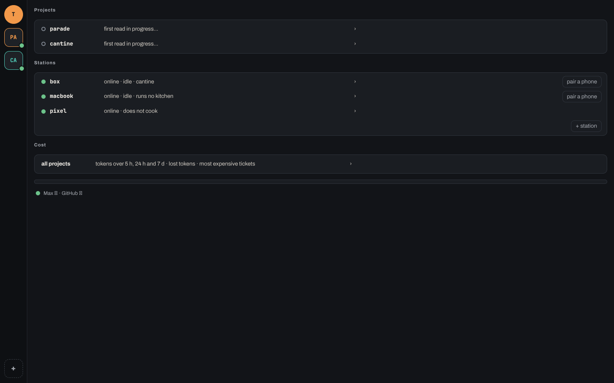

<h1>
  <picture>
    <source media="(prefers-color-scheme: dark)" srcset="docs/logo/brigade-logo-sombre.svg">
    
  </picture>
  brigade — a team of AI agents that works your GitHub tickets
</h1>

You write a ticket and put the label `fire` on it. A **cook** (a `claude` session) takes it in its own git worktree, implements it and opens a pull request. The **pass** judges that pull request — gates, CI, an independent review — and merges it. You decide what matters; brigade does the cooking.



A desktop app shows all of it: your projects, the **rail** of tickets (queued, taken, in the pass, served), the cooks in flight, and a terminal where **the second** — your product assistant — helps you write and prioritize tickets. Everything the system knows lives in durable artifacts (issues, labels, branches, pull requests, a local journal), never in a session's memory: if a cook dies, the committed work survives and the next one picks up from there.

### GitHub is all an app needs

The apps — desktop and phone — need **only your GitHub account** to show and steer your kitchen: the rail, the kitchen's state, the cards that wait for you, and every gesture (merge, remove, answer a card, change a priority). The stations publish everything on a **Kitchen board** issue in each repository and read your gestures from GitHub. No app ever reaches a station by `ssh`.

Three things are outside that rule, on purpose:

- **Watching a cook live** in its terminal reaches the machine it runs on (desktop app only).
- **The second** is a Claude session on your computer: it needs your Claude account too.
- **Installing a station** happens once, on that machine, with your Claude Max session.

## Try it

1. Download the app (macOS, Apple silicon, or Windows x64) or the station package (Debian/Ubuntu, with systemd) from the **[releases page](https://github.com/benomite/brigade/releases)**.
2. Follow **[docs/installation.md](docs/installation.md)**: it takes you from nothing to a first ticket of your own project, cooked and delivered as a pull request. It assumes nothing but that page.

You need a GitHub account with a repository you can push to (a throwaway one is fine for a first run), `git`, `gh` and `claude` installed, and a Claude Max subscription: the cooks run on your Max session, and an API key does not fit.

## Where to read next

- [`docs/installation.md`](docs/installation.md) — install and cook your first ticket.
- [`docs/installer.md`](docs/installer.md) — install a station in one command.
- [`docs/app.md`](docs/app.md) — the app, screen by screen.
- [`docs/runtime/README.md`](docs/runtime/README.md) — the runtime (station, rail, pass): index of its pages.
- [`docs/glossary.md`](docs/glossary.md) — the word for each object of the product (*cook*, *rail*, *station*, *pass*, *served*…).

## Using the V1 plugin

Brigade began as a Claude Code plugin with slash-command roles. That plugin is no longer published from the default branch, but it remains available at the tag **`v1-final`**:

```bash
claude plugin marketplace add benomite/brigade@v1-final
cd <your project> && claude plugin install brigade@brigade --scope project
```

Then restart your session and run `/brigade:init`. V1 is kept as it was and receives no new features. Its history is in the [changelog](CHANGELOG.md#v1-history-tag-v1-final).

## Contributing and project files

- [`CONTRIBUTING.md`](CONTRIBUTING.md) — how to propose a change.
- [`CHANGELOG.md`](CHANGELOG.md) — what changed, release by release.
- [`LICENSE`](LICENSE) — MIT.

The code, the docs and the issues are in English; the dialogue with the agents is in French.
