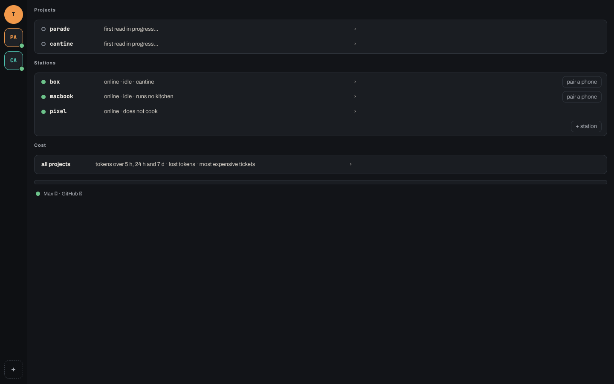

<h1>
  <picture>
    <source media="(prefers-color-scheme: dark)" srcset="docs/logo/brigade-logo-sombre.svg">
    
  </picture>
  brigade — a team of AI agents that works your GitHub tickets
</h1>

Presentation and downloads: **[benomite.github.io/brigade](https://benomite.github.io/brigade/)**.

Brigade works through everything it can do while you are away from your computer, and calls you on your phone only for the choices that are yours.

Brigade is open source (MIT) and free. The agents run on your own Claude subscription. Ready to try it? Jump to **[Try it](#try-it)**.

You write a ticket and put the label `fire` on it. A **cook** (a `claude` session) takes it in its own git worktree, implements it and opens a pull request. The **pass** judges that pull request — gates, CI, an independent review — and merges it. You decide what matters; brigade does the cooking.

A desktop app shows it all: your projects, the **rail** of tickets (queued, taken, in the pass, served), the cooks in flight, and a terminal where **the second**, your product assistant, helps you write tickets. Everything lives in durable artifacts (issues, labels, branches, pull requests, a local journal), never in a session's memory: if a cook dies, the next one picks up the committed work.

## Try it

You need two accounts:

- a **GitHub account**, with a repository you can push to (a throwaway one is fine for a first run);
- a **Claude account**: the cooks run on a Claude Max session, and an API key does not fit.

1. **Download the app** (macOS, Apple silicon, or Windows x64) from the **[releases page](https://github.com/benomite/brigade/releases/latest)** and open it.
2. **Sign in with GitHub**: on its first screen, the app offers a button that opens the GitHub page and shows you a code to type there.
3. **Sign in with Claude**: if the app says the Claude connection is missing, click its **log in** button and sign in with your Max account in the browser.
4. **Pick your repository**: type it as `owner/repo` and click **open this project**. The app clones it, prepares it with a ticket of its own, and tells you when it is ready.
5. **Cook a first ticket**: on GitHub, open an issue in that repository and put the label `fire` on it. A cook takes it, opens a pull request, and the pass judges it and merges it.

No command to type, no file to edit. Every screen is described in **[docs/installation.md](docs/installation.md)**.

## Where brigade is going

1. **Autonomy now:** you leave brigade running and it calls you only for a product or design choice.
2. **Humans as stations:** each human has their own role on each project, and brigade brings each question to the right one.
3. **Any project run on its own, later:** you create a project, talk with the second, and development moves on without you.

The full vision is in [`docs/superpowers/specs/2026-11-07-vision.md`](docs/superpowers/specs/2026-11-07-vision.md).

## Where to read next

- [`docs/index.md`](docs/index.md) — the documentation index, organized by what you want to do.
- [`docs/tutoriels/installer-sur-mac.md`](docs/tutoriels/installer-sur-mac.md) — tutorial: install brigade on a Mac.
- [`docs/tutoriels/premier-projet.md`](docs/tutoriels/premier-projet.md) — tutorial: add a first project and cook its first ticket.
- [`docs/app.md`](docs/app.md) — the app, screen by screen.
- [`docs/runtime/README.md`](docs/runtime/README.md) — the runtime (station, rail, pass): index of its pages.
- [`docs/glossary.md`](docs/glossary.md) — the word for each object (*cook*, *rail*, *station*, *pass*…).

## For contributors

On a project brigade runs in open source, a contributor who has no write access can:

- **Open a pull request** from a fork. The kitchen reviews it and runs the project's gates on it, without the project's secrets, and posts the verdict on the PR. The kitchen never merges it: a human with the `review` role merges it.
- **Open an issue.** Planned: the manager proposes a triage, and the project's `product` human answers before anything is cooked.
- **Run a station from a fork, and claim a ticket.** Planned: the project's `chef` can refuse any contributor station in its settings.

How the kitchen runs an open-source project is in [`docs/runtime/github-seul.md`](docs/runtime/github-seul.md#running-brigade-on-an-open-source-project).

## Contributing and project files

- [`CONTRIBUTING.md`](CONTRIBUTING.md) — how to propose a change.
- [`CHANGELOG.md`](CHANGELOG.md) — what changed, release by release.
- [`LICENSE`](LICENSE) — MIT.

The code, the docs and the issues are in English; the dialogue with the agents is in French.
