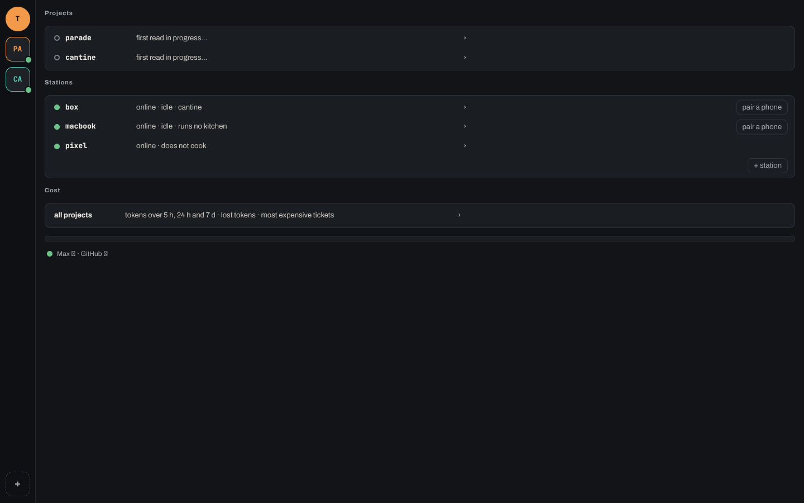

<h1>
  <picture>
    <source media="(prefers-color-scheme: dark)" srcset="docs/logo/brigade-logo-sombre.svg">
    
  </picture>
  brigade — You decide. The kitchen ships.
</h1>

## Install

- **macOS** (Apple silicon): download `Brigade-<version>-mac-arm64.dmg` from the [newest `app-v*` release](https://github.com/benomite/brigade/releases/latest).
- **Linux** (x64): download `brigade-<version>-linux-x64.AppImage` from the [newest `app-v*` release](https://github.com/benomite/brigade/releases/latest), then `chmod +x` it and run it ([details](docs/installation-linux.md)).
- **Windows** (x64): download `Brigade-<version>-windows-x64-setup.exe` from the [newest `app-v*` release](https://github.com/benomite/brigade/releases/latest).

**[Brigade builds itself — see its live autonomy figures](https://benomite.github.io/brigade/autonomie.html)**

You write the ticket, a **cook** takes it, the **pass** merges it: you are called only for product choices. Open source, free. No Brigade account needed — just GitHub and your Claude subscription.

The kitchen's words, once: the **rail** is the line of your tickets, from queued to served; a **cook** is a Claude session that takes one ticket and opens its pull request; the **pass** is the check that judges a pull request (gates, CI, review) and merges it; the **second** is your product assistant, who helps you write the tickets.

Brigade is a team of AI agents that works your GitHub tickets.

Questions, sharing and ideas: **[GitHub Discussions](https://github.com/benomite/brigade/discussions)** is the place to ask a question, share what you cook and propose ideas.

Presentation and downloads: **[benomite.github.io/brigade](https://benomite.github.io/brigade/)**.

**Autonomy you can trust.** Brigade works through everything it can do while you are away from your computer, and calls you on your phone only for the choices that are yours. Every change it makes is bounded, judged before it lands, and left in your repository's history, where you can read it and revert it.

Brigade is open source (MIT) and free. The agents run on your own Claude subscription. Ready to try it? Jump to **[Try it](#try-it)**.

You tell the **second** what to change, and it writes the ticket and puts it on the **rail**. A **cook** (a `claude` session) takes it in its own git worktree, implements it and opens a pull request. The **pass** judges that pull request — gates, CI, an independent review — and merges it. You decide what matters; brigade does the cooking.

A desktop app shows it all: your projects, the **rail** of tickets (queued, taken, in the pass, served), the cooks in flight, and a terminal where **the second**, your product assistant, helps you write tickets. Everything lives in durable artifacts (issues, labels, branches, pull requests, a local journal), never in a session's memory: if a cook dies, the next one picks up the committed work.

## Try it

You need two accounts:

- a **GitHub account**, with a repository you can push to (a throwaway one is fine for a first run);
- a **Claude account**: the cooks run on a Claude Max session, and an API key does not fit.

Before step 1, install these three tools on your computer. The app checks that they are there; it installs nothing itself:

- **Git**: [git-scm.com/downloads](https://git-scm.com/downloads)
- **The GitHub CLI** (`gh`): [cli.github.com](https://cli.github.com)
- **Claude Code** (`claude`): [code.claude.com/docs/en/setup](https://code.claude.com/docs/en/setup)

If one is missing, the welcome screen names it, says why brigade needs it and links to its install page; once you have installed it, click **I installed it** and the app checks again and goes on. The details for each tool are in **[docs/installation.md](docs/installation.md)**.

**The app is not signed.** macOS and Windows refuse an unsigned app the first time you open it; the way through is below, in step 1, and in **[docs/installation.md](docs/installation.md)**.

1. **Download the app** (macOS on Apple silicon, Windows x64, or Linux x64) from the **[releases page](https://github.com/benomite/brigade/releases/latest)**, then open it past the warning. On Linux, see **[docs/installation-linux.md](docs/installation-linux.md)**.
   - **Mac**: drag **Brigade** into **Applications**, right-click it, choose **Open**, then **Open** again. On macOS 15 and later, also open **System Settings > Privacy & Security** and click **Open Anyway**. If macOS says Brigade is "damaged and can't be opened", the app is not damaged and you must not move it to the Trash: open **Terminal**, run `xattr -dr com.apple.quarantine /Applications/Brigade.app`, then open Brigade again.
   - **Windows**: run the installer. When SmartScreen says "Windows protected your PC", click **More info**, then **Run anyway**.
2. **Sign in with GitHub**: on its first screen, the app offers a button that opens the GitHub page and shows you a code to type there.
3. **Sign in with Claude**: if the app says the Claude connection is missing, click its **log in** button and sign in with your Max account in the browser.
4. **Pick your repository**: type it as `owner/repo` and click **open this project**. The app clones it.
5. **Choose the station, and start the kitchen**: the project's page asks `Who cooks <owner/repo>?`. Keep **this computer** (marked `recommended` when it can cook now), then click **Start the kitchen**. If the page offers no station, **choose its machine** first; if it warns that the machine has no sandbox, **continue without sandbox** is your call.
6. **Wait for the setup pull request**: before your own issue moves, brigade cooks and merges a **setup pull request** in your repository (gates, worktree setup, allowed sites). It comes first, and your issue waits for it. It is a cook's ticket like any other, so count a while, not seconds: about the time of one cook ticket, from a few minutes to under an hour, depending on the project and on your quota. It runs on **your Claude quota**, on Opus at high effort. The project's page says what is awaited and from whom; when it ends, it says the project is ready.
7. **Cook a first ticket**: once the project is ready, the second asks you, in the app, what you want to change first. It writes the ticket from your answer and shows it to you; say yes, and it goes on the rail. A cook takes it, opens a pull request, and the pass judges it and merges it.

**Alternative, on GitHub**: open an issue in that repository and put the label `fire` on it. The `fire` label is already there, created by the setup: set nothing else on the issue, and brigade picks the model and the effort itself. It goes on the rail the same way.

You type almost no command: the app runs the tools it needs. What you still type is the GitHub code shown on the GitHub page (step 2), your repository as `owner/repo` (step 4), and your answers to the second (step 7). Every screen is described in **[docs/installation.md](docs/installation.md)**.

## Where brigade is going

1. **Autonomy now:** you leave brigade running and it calls you only for a product or design choice.
2. **Humans as stations:** each human has their own role on each project, and brigade brings each question to the right one.
3. **Any project run on its own, later:** you create a project, talk with the second, and development moves on without you.

The full vision is in [`docs/superpowers/specs/2026-11-07-vision.md`](docs/superpowers/specs/2026-11-07-vision.md).

## Where to read next

- [`docs/index.md`](docs/index.md) — the documentation index, organized by what you want to do.
- [`docs/limites-du-cook.md`](docs/limites-du-cook.md) — what a cook may and may not do.
- [`docs/tutoriels/installer-sur-mac.md`](docs/tutoriels/installer-sur-mac.md) — tutorial: install brigade on a Mac.
- [`docs/installation-linux.md`](docs/installation-linux.md) — install brigade on Linux x64 (AppImage).
- [`docs/tutoriels/premier-projet.md`](docs/tutoriels/premier-projet.md) — tutorial: add a first project and cook its first ticket.
- [`docs/tutoriels/erreur-de-production-a-ticket-corrige.md`](docs/tutoriels/erreur-de-production-a-ticket-corrige.md) — tutorial: from a production error in Sentry to a fixed ticket.
- [`docs/app.md`](docs/app.md) — the app, screen by screen.
- [`docs/runtime/README.md`](docs/runtime/README.md) — the runtime (station, rail, pass): index of its pages.
- [`docs/glossary.md`](docs/glossary.md) — the word for each object (*cook*, *rail*, *station*, *pass*…).

## For contributors

On a project brigade runs in open source, a contributor who has no write access can:

- **Open a pull request** from a fork. The kitchen reviews it and runs the project's gates on it, without the project's secrets, and posts the verdict on the PR. The kitchen never merges it: a human with the `review` role merges it.
- **Open an issue.** Planned: the manager proposes a triage, and the project's `product` human answers before anything is cooked.
- **Run a station from a fork, and claim a ticket.** The project's `chef` can refuse any contributor station in its settings: a refused station claims no ticket.

How the kitchen runs an open-source project is in [`docs/runtime/github-seul.md`](docs/runtime/github-seul.md#running-brigade-on-an-open-source-project).

## Contributing and project files

- [`CONTRIBUTING.md`](CONTRIBUTING.md) — how to propose a change.
- [`CHANGELOG.md`](CHANGELOG.md) — what changed, release by release.
- [`LICENSE`](LICENSE) — MIT.

The code, the docs and the issues are in English; the dialogue with the agents is in French.
