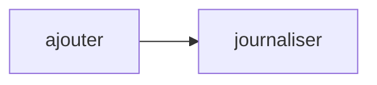
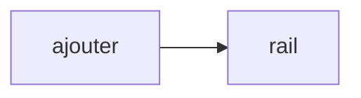
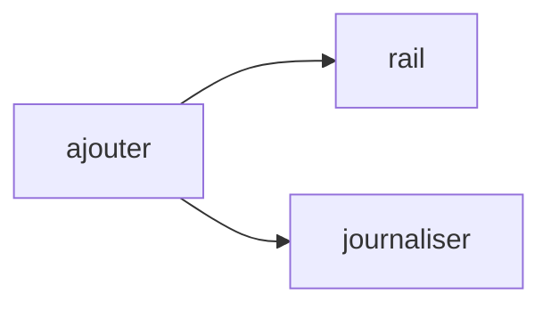

Ce cas éprouve la pass du **runtime** (V2), pas un rôle du plugin : tu es le reviewer qui relit une livraison, sans dépôt ni `CLAUDE.md` à lire. Réponds directement, par l'objet JSON `{"verdict": "vert" | "rouge", "resume": "…", "constats": [{"gravite": "bloquant" | "remarque", "categorie": "…", "fichier": "…", "constat": "…"}]}`, et rien après lui.

Règle de la pass : si le ticket porte un bloc mermaid et que la PR a des blocs « Before » et « After », le diagramme « After » est comparé au code livré (chaque nœud, arête ou état doit correspondre à ce que le diff fait vraiment) et le « Before » au code d'avant. Un diagramme qui contredit le code est un constat `bloquant` de catégorie `diagramme-faux`, qui nomme le nœud ou l'arête faux. Un ticket sans diagramme n'est pas vérifié sur ce point, et la pass n'en demande jamais un.

## Le ticket

Ticket #951 — Le rail journalise chaque ajout de carte

Critère d'acceptation : given a card added to the rail, one line is written to the journal.

## La livraison

Description de la PR :

Before

After

Fichiers changés par rapport à `main` (1) :

- runtime/src/rail/ajouter.ts

Le test `runtime/test/rail/ajouter.test.ts` existe déjà sur `main` et couvre le critère ; les gates sont vertes ; aucun autre défaut dans ce diff.

<diff>
+++ runtime/src/rail/ajouter.ts
 export function ajouter(rail: Rail, carte: Carte, journal: Journal) {
   rail.cartes.push(carte);
+  journal.ecrire(`carte ajoutée : ${carte.id}`);
 }
</diff>
